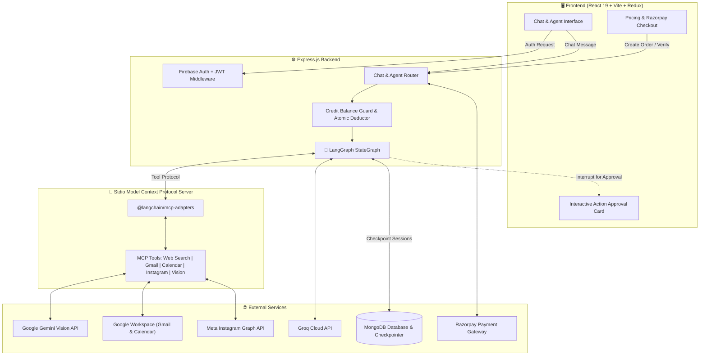
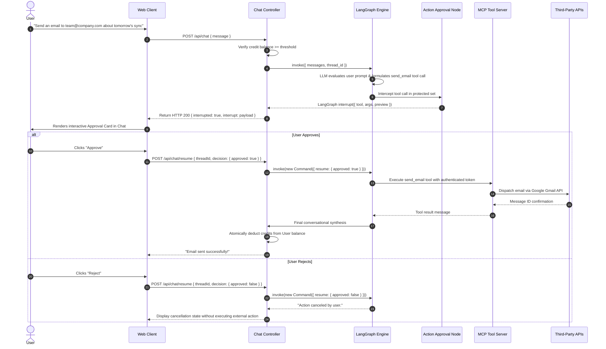
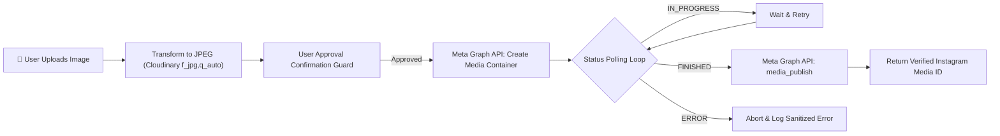
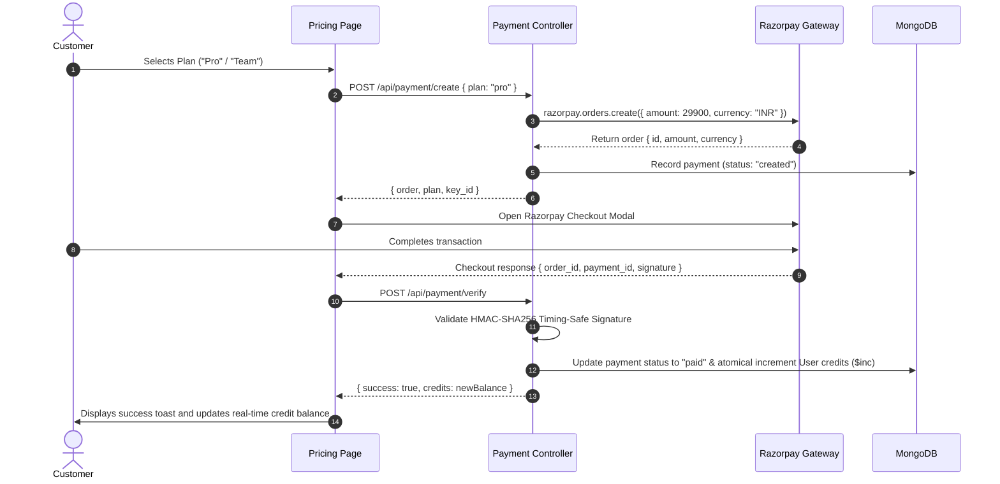

<div align="center">

# ⚡ Automate AI

### *Autonomous Multi-Agent Workflow Engine with Human-in-the-Loop Approvals*

[+Enabled;Human-in-the-Loop+Safety+Guards;Integrated+Credit+Economy+via+Razorpay)](https://git.io/typing-svg)

<p align="center">
  
  
  
  
  
  
</p>

</div>

---

## 📖 Overview

**Automate AI** is an enterprise-grade agentic assistant that coordinates specialized AI tools using **LangGraph** and the **Model Context Protocol (MCP)**. It bridges natural language reasoning with real-world task execution—managing Google Calendar schedules, composing and dispatching Gmail messages, publishing verified Instagram media containers, analyzing multimodal vision prompts, and managing account credits via Razorpay.

---

## 🚀 Architecture & Core Flows

### 1. High-Level System Architecture



---

### 2. Conversational & Human-in-the-Loop Approval Flow

High-stakes tool executions (sending emails, scheduling calendar events, and publishing Instagram posts) are protected by a stateful **Human-in-the-Loop (HITL)** interruption boundary.



---

### 3. Instagram Media Publishing Pipeline



---

### 4. Credit Economy & Payment Verification Flow



---

## 🛠️ Tech Stack

### Frontend (`client/`)
- **React 19** & **Vite 8**
- **Tailwind CSS v4** & **Shadcn UI**
- **Redux Toolkit** (Global state management for user profile & agent configurations)
- **React Router v7**
- **Razorpay Checkout SDK** (Embedded checkout modal)
- **Lucide React** (Vector icons)

### Backend (`server/`)
- **Node.js (v24 ESM)** & **Express.js**
- **LangChain & LangGraph** (StateGraph orchestration, MongoDB Checkpointer)
- **Model Context Protocol (MCP)** (@modelcontextprotocol/server & @langchain/mcp-adapters)
- **Groq SDK** (`openai/gpt-oss-120b`, `llama-3.3-70b-versatile`)
- **Google Generative AI** (`gemini-3.8-flash`, `gemini-3.8-pro` vision fallback cascade)
- **MongoDB & Mongoose 9** (Data models & atomic credit operations)
- **Firebase Admin SDK** (Token verification)
- **Google APIs** (Gmail v1 & Calendar v3)
- **Razorpay Node SDK** (Order creation & HMAC-SHA256 verification)
- **Crypto (AES-256-GCM)** (Secure token encryption at rest)

---

## 📂 Project Structure

```
AutomateAi/
├── client/                     # Frontend Single Page Application
│   ├── src/
│   │   ├── components/         # Reusable UI components (buttons, cards, dialogs)
│   │   ├── features/           # API interaction modules (auth, chat, payment, agent)
│   │   ├── pages/              # Primary views (HomePage, Pricing, CreateAgent)
│   │   ├── redux/              # Redux slices (userSlice, agentSlice, store)
│   │   └── api.js              # Centralized Axios client with credential handling
│   ├── tests/                  # Frontend unit test suites (Node native runner)
│   └── package.json
│
├── server/                     # Backend API & Agentic Execution Service
│   ├── src/
│   │   ├── config/             # Environment, DB, Razorpay, Firebase & OAuth configs
│   │   ├── controller/         # Request controllers (chat, auth, agent, payment)
│   │   ├── mcp/                # Stdio MCP Server & LangChain adapter integration
│   │   ├── middleware/         # Authentication & request protection middlewares
│   │   ├── model/              # Mongoose schemas (User, Agent, Payment, Integration)
│   │   ├── routers/            # Express routers (/api/chat, /api/payment, etc.)
│   │   └── utils/              # Graph workflows, image transformers, rate-limit retry
│   ├── tests/                  # Backend unit test suites
│   └── package.json
└── README.md
```

---

## 🧪 Testing Suite

Automate AI includes a comprehensive test suite built with Node.js's native test runner (`node:test` & `node:assert/strict`) requiring zero external test dependencies:

```bash
# Run server test suite (56 tests across 15 suites)
npm --prefix server test

# Run client test suite (9 tests across 2 suites)
npm --prefix client test

# Verify production frontend build
npm --prefix client run build
```

### Coverage Highlights:
- **`analyze_image.test.js`**: HTTPS scheme validation, MIME type filtering (JPEG/PNG/WebP), size boundary (<10MB), and MCP output compliance.
- **`payment.test.js`**: Razorpay plan validation, order creation, idempotent verification, and timing-safe signature checking.
- **`deduct_credits.test.js`**: Atomic balance decrements (`$inc`), negative balance prevention (`$gte`), and user presence checks.
- **`instagram.test.js`**: Cloudinary JPEG URL conversion (`f_jpg,q_auto`), access token sanitization, and container creation/polling lifecycle.
- **`auth_crypto.test.js`**: AES-256-GCM round-trip encryption, random IV verification, and tampering detection.
- **`message_sanitizer.test.js`**: Groq string content normalization, multimodal array flattening, and tool message preservation.
- **`retry.test.js`**: HTTP 429 rate-limit parsing, exponential backoff, and retry window exhaustion.

---

<div align="center">

Made with ❤️ by **Mann**

</div>
